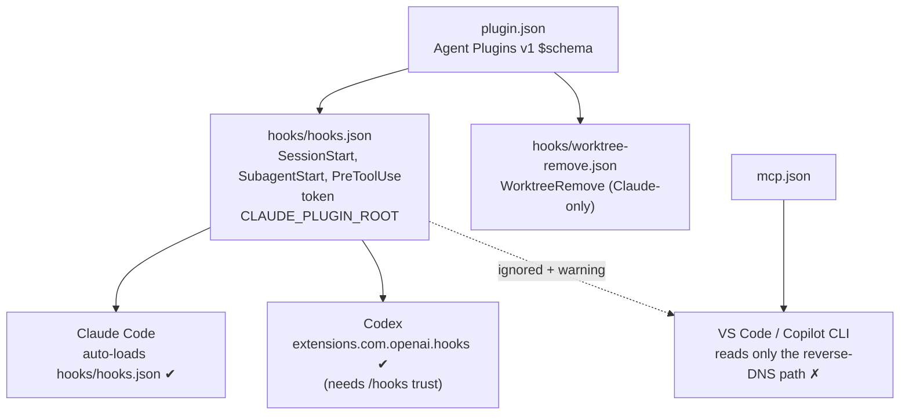
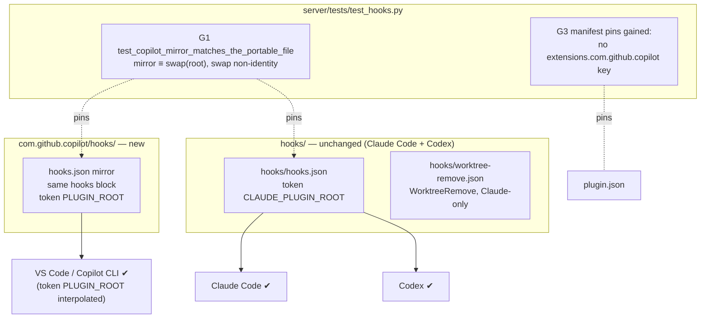

# Hook namespace — Architecture Analysis (v0)

Date: 2026-11-27. Report id `R01` (hook_namespace) in the `AGENTS.md` legend.

## Executive Summary

- **Problem.** The root `plugin.json` declares the Agent Plugins v1 `$schema`, and every
  loader that claims a v1 manifest then reads that plugin's hooks *only* from its own client
  extension directory — `com.github.copilot/hooks/hooks.json` for VS Code / Copilot. This
  repository ships its hooks at `hooks/hooks.json` and `hooks/worktree-remove.json`
  instead, so a Copilot/VS Code session shows "Some hook files could not be loaded" naming
  `hooks/hooks.json` as no longer read, and **no hook fires there**: no search policy at
  session/subagent start, no `PreToolUse` gate on `Grep|Bash`, no `WorktreeRemove` index
  cleanup — while the MCP server itself connects normally.
- **Proposed change.** Add one mirror file, `com.github.copilot/hooks/hooks.json`: the
  portable groups of `hooks/hooks.json` with the launcher root token swapped to
  `${PLUGIN_ROOT}` (the v1 loader interpolates that token only). Root `hooks/hooks.json`
  and `hooks/worktree-remove.json` stay byte-unchanged. Two drift guards pin the pair (the
  third candidate was mutation-checked and cut — §Alternatives row "Guard set"); docs teach
  the layout in `README.md`, `AGENTS.md` and `dev/skills/stack-traps/`.
- **Cross-compatibility.** Only the v1 client path changes. Codex resolves
  `extensions["com.openai"].hooks` → `./hooks/hooks.json` — naming that file *is* loading
  it — so nothing of Codex's moves; Claude Code auto-loads `hooks/hooks.json` and reads its
  manifest `hooks` field as *additional* files, unchanged; Cursor never reads plugin hooks
  at all. `WorktreeRemove` stays Claude Code-only and is deliberately **not** mirrored. Other
  Agent Plugins 1.0 clients (Antigravity / Open Plugin, `.plugin/`-rooted) read their own
  namespace directories — same bug class, different constant: a follow-up notice, not this
  change.
- **Non-goals.** No change to `hooks/colgrep_policy.py`, any `server/` file, version fields,
  root `plugin.json`, `mcp.json`, or `colgrep-mcp.spec.json` (that spec is byte-identical to
  Pinion's example copy and stays so). No removal of root `hooks/hooks.json` — that needs the
  Pinion generator change plus a Claude filename oracle and is Phase B. No non-Copilot
  namespace mirrors.
- **Biggest risks.** The legacy root file may keep the *notice* alive in VS Code even after
  hooks work (probe-verified, accepted residual); the two hook copies can drift without
  guards (the reason for G1); a future `extensions["com.github.copilot"]` path config with
  `exclusive: true` can bypass the default directory through the one manifest route that
  exists (the reason for G3); a "cleanup" that touches Codex's key or the root file would
  silently re-break Claude/Codex (already pinned by `test_manifests_name_the_hook_files_per_ecosystem`).
- **Validation approach.** Guard red runs first (each named bug below, mutated, watched red,
  restored — `designing-tests` discipline; the commit body names every red run), then the
  full gate suite, then the loader probes in `verify/`: the Claude scratch-marketplace
  install oracle (the only check exercising install-path rules `plugin validate` never runs),
  a static Codex-resolution walk, a VS Code session observation, and a mirror spot-check.

## Evidence

The claims rest on loader sources, not on the warning text alone:

| # | Source | What it establishes |
|:--|:--|:--|
| E1 | `microsoft/vscode` `src/vs/platform/agentPlugins/common/pluginParsers.ts` | The v1 format's `hookConfigPath` and `componentPaths.hooks` are the fixed string `com.github.copilot/hooks/hooks.json` (`AGENT_PLUGIN_COPILOT_EXTENSION_NAMESPACE`); the format config interpolates only `${PLUGIN_ROOT}` (`hookPluginRoot`/`interpolateHookPluginRoot` inject env `PLUGIN_ROOT`); legacy formats use `${CLAUDE_PLUGIN_ROOT}`; an `extensions[<ns>]` section may set `paths`/`exclusive` components (`parseComponentPathConfig`, `resolvePluginComponentDirs`) |
| E2 | `microsoft/vscode` `src/vs/workbench/contrib/chat/common/plugins/AGENTS_PLUGINS.md` | One-line contract table: v1 "Hooks config: `com.github.copilot/hooks/hooks.json` client extension"; Claude `hooks/hooks.json`; Codex/Open Plugin `hooks/hooks.json` |
| E3 | `microsoft/vscode` `src/vs/platform/agentHost/node/copilot/sessionCustomizationDiscovery.ts` | Emits the exact notice in the bug report ("Some hook files could not be loaded") as a degradation entry with per-file messages |
| E4 | third-party verification comment (`PackmindHub/packmind` `RenderPackageAsPluginUseCase.spec.ts`) | "Verified against Copilot CLI 1.0.82": a manifest declaring the v1 `$schema` has hooks read *only* from `com.github.copilot/hooks/hooks.json`; the root file logs the same "move it there" message and runs no hook |
| E5 | `cyberuni/universal-plugin` plan `github-67-copilot-namespace` | Independent report of the same class: "the plugin root is no longer read for [native components]" under the canonical `$schema` |
| E6 | `openai/codex` `core-plugins/src/agent_plugin_manifest.rs` + `hooks/src/engine/mod_tests.rs` | Codex resolves `extension.paths.hooks` from `extensions["com.openai"]` into the loader paths and feeds that JSON to its hook engine (`PluginHookSource` over `hooks/hooks.json` in this exact nested shape); plugin hooks stay inert until a one-time `/hooks` trust |
| E7 | `hooks/hooks.json` on disk | Top level `{"description", "hooks"}` with groups `SessionStart`, `SubagentStart`, `PreToolUse` (`matcher: "Grep|Bash"`), one launcher string each — the file the mirror copies |

## Current State

## Proposed State

## Contracts & Invariants

- **C1 token-per-loader rule.** A hook command's root placeholder is the token its loader
  expands: `${CLAUDE_PLUGIN_ROOT}` in `hooks/` (Claude Code, Codex), `${PLUGIN_ROOT}` in
  `com.github.copilot/hooks/` (v1). Exactly one placeholder per command; it is the only one.
- **C2 one policy, two spellings.** `com.github.copilot/hooks/hooks.json`'s `hooks` block
  equals `hooks/hooks.json`'s with C1's swap applied. The two files' `description` keys are
  free prose and are not compared (no consumer reads them).
- **C3 portable-only events.** Every event in the mirrored block is one of the three portable
  events actually used (`SessionStart`, `SubagentStart`, `PreToolUse`), inheriting the root's
  portable-only pin. `WorktreeRemove` never reaches a v1 parser: no mirror for it, and its
  per-event file stays outside any namespace directory.
- **C4 no manifest route to the hooks.** Root `plugin.json` keeps no top-level `hooks` key
  (v1 whitelist) and gains **no** `extensions["com.github.copilot"]` key: its `hooks` value
  would be a path config that, set `exclusive`, disclaims the default directory and
  reintroduces today's bug through the only manifest route (E1).
- **C5 Codex's contract is untouched.** `extensions["com.openai"].hooks == "./hooks/hooks.json"`
  stays exactly as is; an explicit value *replaces* Codex's default discovery, so it must keep
  naming the root portable file.
- **Error model.** Both hook files are static config: repo-side failures surface as pytest red
  (G1/G3) or as the loader notices of E3/E5; runtime loader behaviour is *observable, not
  owned* and belongs to the probes (`verify/loader_probes`). The policy script fails open on
  every path and is unchanged.

## Alternatives Considered

| Option | Why not (or why later) | Tradeoff accepted |
|:--|:--|:--|
| **A1 mirror under `com.github.copilot/hooks/` (chosen)** | — | Two copies of one policy exist; kept equal only by G1. Residual legacy notice possible (risk R1) |
| A2 move-only: delete root file, keep everything under the namespace dir, repoint both manifest hooks fields | Requires (a) a Claude marketplace-install oracle naming `./com.github.copilot/hooks/hooks.json` (plausible, unproven — `plugin validate` never runs that rule), (b) Pinion generator + spec lockstep change (AGENTS.md pins `colgrep-mcp.spec.json` to Pinion's example byte-for-byte), (c) a shared script idiom using injected env `PLUGIN_ROOT`/`CLAUDE_PLUGIN_ROOT`, since no single token interpolates in both families (E1) | Deferred to Phase B as candidate `c1`; A1 does not block it |
| A3 drop the `$schema` (stay a legacy plugin, where `hooks/hooks.json` works) | Wrong direction: the schema is honest, the layout was wrong; it would also drift the spec lockstep and hide v1 conformance | — |
| A4 drop hooks for v1 clients | The hooks *are* the plugin's enforcement surface (policy + tool gate) | — |
| A5 mirror verbatim, keep `${CLAUDE_PLUGIN_ROOT}` | E1: the v1 loader interpolates only `${PLUGIN_ROOT}`; the hook would launch with an unresolved token path and fail open every time | Caught by G1's non-identity/swap equality (mutation listed below) |
| **Guard set: G1 + G3, not three** | Mutation analysis on the planned third guard (extend `test_every_handler_launches_the_one_script_through_the_one_launcher` to the mirror): once G1's `mirror ≡ swap(root)` holds and the *existing* sweep covers `hooks/`, every per-command property (prefix, one placeholder, script exists, timeout) is implied transitively — no plausible bug turns only that extension red, so it is a tautology (`designing-tests` distinct-failure rule) | Slightly smaller suite; the rationale is recorded here so nobody re-adds it as "coverage" |

## Mutation log (each guard, named bug, red run)

| Guard | Named plausible bug | Mutation | Seen red |
|:--|:--|:--|:--|
| G1 | policy divergence between the copies (dropped group / drifted matcher, timeout, statusMessage) | delete the mirror's `PreToolUse` group | ✅ before merge |
| G1 | verbatim copy with the wrong token (A5) | copy root file byte-for-byte (keeps `${CLAUDE_PLUGIN_ROOT}`) | ✅ before merge |
| G1 | root side loses its token (swap becomes identity) | replace root's token with `${PLUGIN_ROOT}` | ✅ before merge |
| G3 | `extensions["com.github.copilot"].hooks` with `exclusive` bypassing the default dir | add such a key to `plugin.json` | ✅ before merge |

Deliberately **not** tested: loader-parser internals (E1–E5 are the evidence); Codex runtime
(probe 2, static); `description` prose of either file; `statusMessage` cosmetics in the mirror
beyond G1's equality; a `com.github.copilot` copy of `worktree-remove.json` (must not exist —
invariant C3, and a file-level guard for "absence of a file nobody creates" is the classic
tautology). The policy script's behaviour keeps its existing suite.

## Risks & Mitigations

| # | Risk | Mitigation |
|:--|:--|:--|
| R1 | VS Code may keep the "no longer read" notice while the root file exists | Probe 3 records whether it survives verbatim; hooks work regardless (E4); accepted residual per maintainer decision; Phase B candidate `c1` removes the file if the notice is judged a nuisance |
| R2 | The two hook copies drift silently | G1 (C2) — any divergence is pytest red, both directions |
| R3 | A future manifest edit re-bypasses the default dir | G3 (C4) |
| R4 | A "cleanup" breaks Codex/Claude (root file moved/"simplified", `com.openai` key edited) | `test_manifests_name_the_hook_files_per_ecosystem` pins (C5) + README/AGENTS wording (L2) + probe 2 re-checks resolution at cycle close |
| R5 | The new directory trips a Claude install-path rule we cannot see from here | Probe 1: scratch-marketplace `marketplace add` → `install` → `list` → remove; the only oracle for those rules (stack-traps `claude-code.md#hooks-manifest-duplicate`) |
| R6 | Both files end up with the wrong/absent token (loader family mismatch) | G1's swap equality + non-identity assertion; probe 4 spot-checks the mirrored command's behaviour against a real interpreter run |

## File Ownership (per leaf, disjoint)

| Owner | Files |
|:--|:--|
| `mirror_and_guards` (L1) | `com.github.copilot/hooks/hooks.json` (new), `server/tests/test_hooks.py` |
| `docs_and_naming` (L2) | `README.md`, `AGENTS.md`, `dev/skills/stack-traps/SKILL.md`, `dev/skills/stack-traps/references/claude-code.md` |
| `verify/loader_probes` (L3, read-only) | `__reports__/hook_namespace/01-observation_loader_probes_v0.md` (its own report only) |
| lead | `__reports__/hook_namespace/**`, `__roadmap__/hook_namespace/**`, merges, gates |

Anything else noticed is reported in a final message, never edited (campaign-lead §Rules).

## Roadmap Recommendation

Complexity Tier 1-2: two file-disjoint lead-sized leaves in parallel, one read-only verify
level after them (`__roadmap__/hook_namespace/`, authored with `dirtree-rdm`). No dispatch
round: every leaf is smaller than its dispatch overhead (the campaign-lead exception for
lead-sized leaves) — recorded in the cycle's knowledge-transfer report. Milestone sketch:

1. `mirror_and_guards` — mirror + G1 + G3 (one commit, red runs named).
2. `docs_and_naming` — README/AGENTS.md/stack-traps (two commits).
3. `verify/loader_probes` — four probes → `01-observation_loader_probes_v0.md`; then the
   knowledge-transfer close (`01-knowledge_transfer_v0.md`) and the gates/PR.
