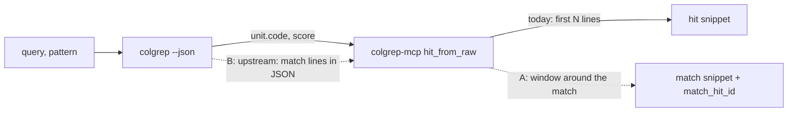

# Observation: a search hit on a long markdown file shows the file's first lines, not the lines that matched (v0)

date: 2026-10-24 · observed from: the Murmuration lab (wave 8, explorer-w08-b and the PI) · colgrep 1.6.2, colgrep-mcp 0.5.2

## In one paragraph

colgrep indexes a markdown file as one unit (`unit_type: document`, lines 1 to the end of the
file). Its **text** renderer still shows the lines inside that unit that match the query: on a
319-line note it printed lines 137–139, where the answer is. Its **`--json`** output, which this
server reads, carries only the unit (its whole `code`) and a score, with no match location. So
`search` can only show the unit's first `snippet_lines` lines (`tools_search.py::hit_from_raw`,
`code_lines[:snippet_lines]`), and `expand` reads the unit from its first line (`max_lines`
default 200). For a long note the hit is a path and a title; the agent must open the file. In the
Murmuration lab this is why workers read notes whole: 152 of 175 whole reads of markdown in four
waves, and documents are 14.3% of what its workers pay to carry context.

## Evidence

| Probe | What came back |
|:--|:--|
| `colgrep -n 3 -k 3 "PI decision on w05-c1's ESCALATE" __statera__/wave-05.md` (text) | the unit header (`1 # Wave 05`), then `137 - 16:16 (the closing commit), at close:`, `138   - **PI decision on w05-c1's ESCALATE:**`, `139 …`: the matching lines |
| same query, `--json -k 1` | one hit: keys `unit`, `score`; `unit.line` 1, `unit.end_line` 319, `unit_type` `document`, `code` 25,228 characters; no field for the matching lines |
| MCP `search` on the lab's `__statera__/` (query about the same decision) | four hits, each `unit_type: document`, `hit_id` `…:1-51`, `…:1-26`, …, `snippet` = the file's first three lines (`# Hand-backs of …`); the note that holds the answer is not in the top four |
| MCP `expand` on `__statera__/wave-07.md` (603 lines; explorer-w08-b) | `truncated: true` at line 200; the answer at line 470 is out of reach without `max_lines` |

Code: `server/colgrep_mcp/tools_search.py`, `hit_from_raw`:
`snippet = "\n".join(code_lines[:snippet_lines])`. The server already holds the whole `code`,
the query, and the optional `pattern`, so it can find the matching lines itself.

## Two places to fix it

**A. In this server (no upstream change).** When building a hit:
1. With `pattern`: find the first regex match in `code`; else score each line of `code` by the
   query's terms (case-folded, stop words out) and take the densest window.
2. Return the window as `snippet` (keep `snippet_lines`), plus `match_line` and a narrowed
   `match_hit_id` (`<file>:<a>-<b>`) that `expand` reads directly. Keep `hit_id` as the unit.
3. For `document` units, let `expand` accept a hit id whose range is inside the unit (it already
   reads `[line, end_line]` off disk), so an agent reads 20 lines, not 200.

Cost: a few dozen lines in `tools_search.py`, a field in `SearchHit`, tests. Risk: the window
picks the wrong lines for a purely semantic match with no shared words; fall back to the first
lines and say so (`match_line: null`).

**B. Upstream in colgrep.** Ask for the text renderer's match lines in `--json` (for example
`matches: [{line, text}]` per hit). Then A becomes a pass-through and agrees with the CLI.

**C. Also upstream, separable.** A section-level unit for markdown (one unit per heading)
would make ranking itself section-aware: today a 600-line note competes as one unit, so the right
note may rank below short files that share words (the probe above).

## What to test

- A 300+ line markdown file with the answer past line 200: `search` snippet shows it, and
  `expand(match_hit_id)` returns under 30 lines.
- `pattern` given: the window holds the first regex match.
- Code units: unchanged behaviour (the function's first lines are usually right), or the window
  only when the match is past `snippet_lines`.
- A semantic-only hit: `match_line: null`, first lines as today.

## For the skill, meanwhile

`colgrep-search` could say: for a note or report, a hit tells you the file; then `grep -n` the
heading or term in that one file and `sed -n 'a,bp'` the lines, rather than `expand`.

## Pointers

Murmuration lab (local): `__reports__/wave-08/explorer-w08-b/00-findings_v0.md` (23 questions,
top-k rates, unit sizes), synthesis open item 43.
