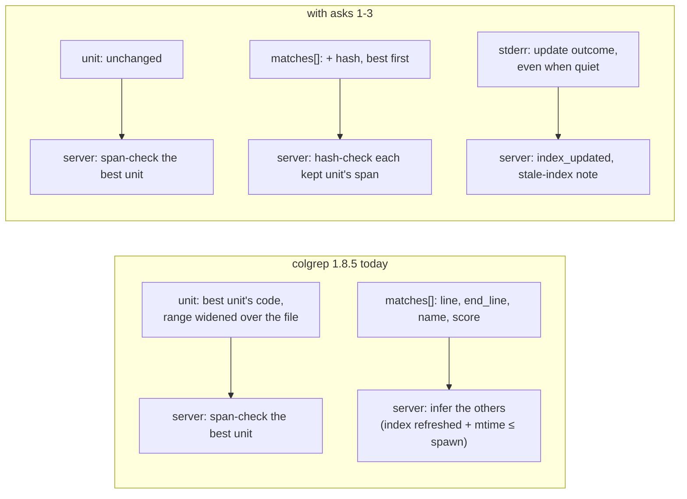

# Match Units — Findings: what colgrep should report so the server can check, not infer (v0)

Date: 2026-11-01

---
type: findings
topic: match_units
date: 2026-11-01
version: v0
prior-version: none
key-metric: hits whose location is inferred rather than checked: 35 of 110 (32 %) (prior: N/A, delta: N/A)
decision-required: confirm
---

## Headline Result

metric: share of `search` hits whose `location_verified` rests on an inference instead of a check against the unit's own content
value: 35 / 110 (32 %)
unit: hits, colgrep 1.8.5+cs.1, 5 queries on a scratch copy of Murmuration's `__statera__`
prior: N/A (first run)
direction: new

Every non-best unit of a file is in this class. The server has no content to check it against, because colgrep sends `code` only for the best unit. Ask #1 below would bring the number to 0.

## Results Tables

### The asks, most valuable first

Source lines are at fork commit `7f1e855` (`install/markdown-sections`, upstream v1.8.5 plus one fork commit).

| # | Ask | colgrep today | Server workaround today | Removes |
|:--|:--|:--|:--|:--|
| 1 | Add a content hash of each unit to every `matches` entry | `UnitMatch` carries `line`, `end_line`, `name` and `score` only (`colgrep/src/index/mod.rs` `UnitMatch`). `absorb_matches` already holds each unit's `code` when it merges (`index/mod.rs:3497-3510`) | Non-best units are trusted when the best unit is span-verified, the index was refreshed, and the file's mtime is no later than the spawn time | The whole mtime inference, plus all three accepted gaps below |
| 2 | Keep the best unit at `matches[0]` | `absorb_matches` sorts every entry by score, then by line ascending. On a tie, `matches[0]` may not be the unit whose `code` is in `unit` | `adapter.unit_matches` re-picks the leader by line count and display name | The tie heuristic, and the unnamed-tie gap |
| 3 | Report the pre-search update outcome under `--json` (refreshed, skipped because the index is locked, or rebuilt) | `quiet = json \|\| files_only` (`commands/search.rs:1127`) also hides "Index is being updated by another process, searching existing index..." (`search.rs:1273-1281`) | None possible: the lock-skip is silent. `index_updated` keys on "Building index", so it misses incremental re-indexing | The lock gap, and a wrong `index_updated` |
| 4 | Collapse results per file across all search paths before taking the top `-k` | `cmd_search` collapses per path, then concatenates and takes the top k (`search.rs:543-613`) | `search` dedupes on (file, line, end_line, name). `find_files` over-fetches with `limit*3` | The dedupe, and `find_files`' threefold over-fetch |

### What not to ask

| Candidate | Why not |
|:--|:--|
| Make `unit.line..end_line` the best unit's own range | It is widened over the file's matches on purpose (`collapse_by_file`, `index/mod.rs:4807`), and other consumers may read it as the file's hit span. `matches[0]` already gives the true range |
| Include full `code` for every `matches` entry | It multiplies the JSON payload by the number of matched units, which can be 30 per markdown file, and the server keeps only `limit` units. A hash is a few bytes |
| Move verification against disk into colgrep | colgrep cannot know what the server reads after it exits. The check belongs where the read happens; colgrep only has to state what it indexed |

### Gaps the server accepts today

These are measured by the adversarial review of `match_units`. Probes were in that session's scratchpad and are not committed.

| Gap | How it shows | Window | Closed by |
|:--|:--|:--|:--|
| Another process holds the index lock | colgrep searches the old index silently. A file edited before the call keeps its later units trusted | Concurrent indexing of the same project | #1, or #3 |
| A file replaced with its mtime and size preserved (`cp -p`, `rsync -t`, or `os.utime` after a same-size edit) | colgrep's change scan skips it (ns-mtime and size equal), and so does the server's mtime rule. Later units come back off by one under the right name | Tools that preserve metadata | #1 |
| An exact score tie between two unnamed units of equal length | The wrong unit leads, giving a duplicate `hit_id` and a missing unit | Exact float ties only | #2 |

## Observations

| Signal | Baseline / Expected | Observed [source] | Interpretation |
|:--|:--|:--|:--|
| Best units verified by exact span | Most, if colgrep 1.8 ranges are exact | 75 / 75, with 0 whole-file reads [verifier's real-binary probe] | colgrep's own unit ranges are exact. Only the widened `unit` range was ever wrong (R05 D1) |
| Non-best units trusted by a name-on-first-line rule | Close to 100 % on unedited notes | 22 / 35. The 13 failures were all continuation chunks of long sections [first verifier pass] | Names don't identify ranges. A heuristic was the wrong tool, which is why the rule moved to index freshness |
| Non-best units trusted by the index-freshness rule | Close to 100 % on unedited notes | 35 / 35 [recheck] | Sound wherever colgrep's change detection is sound, and no sounder |
| Lock-skip signal under `--json` | Present on stderr | Absent: stderr `''`, exit 0, results returned [implementer probe with `.lock` held] | A correctness signal is being silenced together with progress chatter |
| Multi-path collapse | Global | Per path [`search.rs:543-613`] | `-k` counts results, not distinct files, so `-k limit` cannot replace the over-fetch |

## Charts & Visualizations


*Caption: where `location_verified` comes from today, and with asks #1–#3. Ask #4 changes only how many results `-k` admits.*

```
hits on statera (110)      checked ███████████████████████████████████████ 75
                           inferred ██████████████████ 35   ← 0 with ask #1
```
*Caption: 110 hits over 5 queries, split by how the location was established.*

## Contradictions & Surprises

- colgrep's `--json` mode is the one every agent integration uses, and it is also the one mode that hides the lock-skip warning.
- The original "colgrep reports wrong line numbers" finding (R05 D1, 1.6.2) is explained by the widening in `collapse_by_file`, not by bad unit ranges. Every unit range checked here was exact.

## Steering Questions

- [now] Open #2 and #3 upstream first, as two separate single-concern PRs from the CrackingShells fork? Both are a few lines, and outside PRs of that shape get merged.
- [now] For #1, which hash? colgrep already hashes file contents for change detection (`compute_update_plan`, `index/mod.rs:3296+`). Reusing that algorithm avoids a new dependency. The server must hash spans the same way, including the `\n`-only line rule.
- [next run] When a colgrep release with #1 exists, should the server prefer the hash and keep the mtime rule only for older binaries? Or should the soft minimum move to that release and the mtime rule go?
- [next run] If #4 lands, switch `find_files` to `-k limit` and drop the dedupe. The step 5 test in `__roadmap__/match_units/unit_pipeline.md` already describes the argv check.
- [later] Does #3's update outcome belong on stderr, or in a JSON envelope behind a flag? The bare-array output is what existing consumers parse.

## Pointers

- `__roadmap__/match_units/` — the campaign, its leaves and gates
- `__reports__/match_units/00-knowledge_transfer_v0.md` — how these gaps were found
- `__reports__/match_lines/00-observation_markdown_match_lines_v0.md` (OBS-M) — why the per-unit hits exist
- `server/colgrep_mcp/adapter.py` `unit_matches`; `server/colgrep_mcp/tools_search.py` `hits_from_raw`, `_do_search`
- [CrackingShells/colgrep-mcp#18](https://github.com/CrackingShells/colgrep-mcp/pull/18)
- Upstream: [lightonai/next-plaid](https://github.com/lightonai/next-plaid); fork: CrackingShells/next-plaid, branches `feat/markdown-sections` and `install/markdown-sections`
