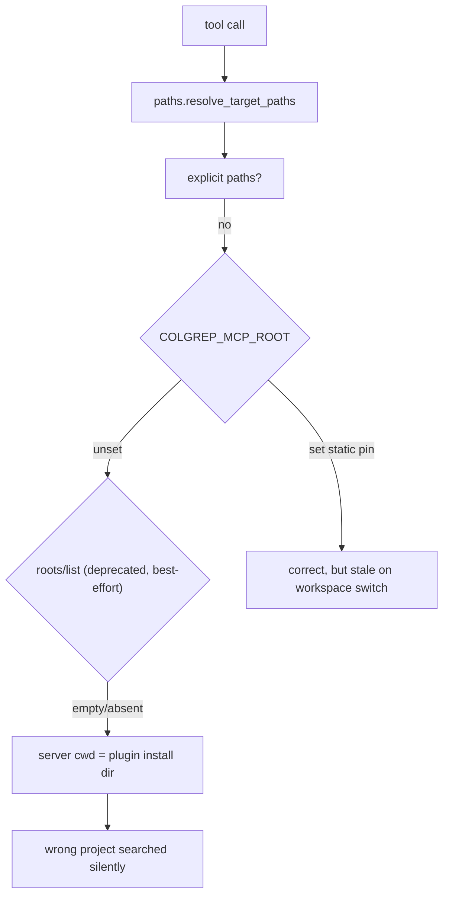
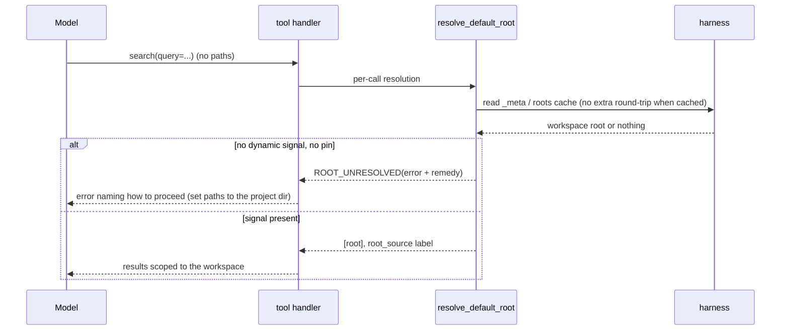

# Dynamic workspace discovery — Architecture Analysis (v0)

Date: 2026-11-12

## Executive Summary

- **Problem**: colgrep-mcp's default root resolution silently lands on the server
  process's own cwd (the plugin install tree) whenever `COLGREP_MCP_ROOT` is unset
  and the client sends no roots, so every path-less tool call searches the wrong
  project and the model must repeat the path. Confirmed this session:
  `doctor` reported `default_root: .../agentPlugins/.../1a1c9036c4d (source: cwd)`
  and path-less `search` returned only plugin-tree hits.
- **Proposed change**: probe which dynamic per-call workspace signals each target
  harness actually sends (request `_meta`, `initialize` context, `roots/list` +
  successor channels per the 2026-07-28 MCP revision), then resolve the default
  root per tool call from the strongest available signal. Survey + fleet evidence
  feed a findings report; this document fixes the resolution contract.
- **Non-goals**: no behaviour change in this campaign beyond a probe facility that
  is inert unless `COLGREP_MCP_PROBE` is set; no skill/schema guidance asking the
  model to pass `paths` (rejected as a token-priced workaround); no hook-based
  workspace plumbing (Agent Plugins hosts ignore `hooks/`).
- **Biggest risks**: (1) probe code accidentally altering resolution behaviour —
  guarded by a verifier dispatch against a dump-only oracle; (2) no dynamic
  channel exists in some harness — the contract turns that into fail+guidance,
  not a silent wrong root; (3) harness probe runs are flaky/timeout-prone —
  artifacts record raw evidence, gaps are reported, not filled.
- **Validation approach**: `pytest` + `ruff` green per leaf; verifier attack on the
  dump-only invariant; harness probe artifacts JSON-checked for completeness by a
  deterministic predicate, not read by eye.

## Current State



## Proposed State

```mermaid
graph TD
    T[tool call] --> R[resolve_default_root per call]
    R --> R1[R1 request _meta / initialize workspace stamp]
    R1 -.->|absent| R2[R2 roots: list_changed cache, lazy roots/list]
    R2 -.->|absent| R3[R3 COLGREP_MCP_ROOT pin (env)]
    R3 -.->|unset| R4[R4 guarded cwd]
    R4 -->|cwd looks like install tree| E["ToolError ROOT_UNRESOLVED + guidance: pass an absolute paths entry"]
    R1 --> OK[resolved root, root_source recorded]
    R2 --> OK
    R3 --> OK
```

## Key Flows



## Contracts & Invariants

- **Resolution ladder** (the only place this lives: `paths.py`):
  `explicit paths > dynamic workspace signal (verbatim, per call) > COLGREP_MCP_ROOT pin > guarded cwd`
  . Relative `paths` entries resolve against the chosen default root. Multiple dynamic roots select by
  `paths` containment first, else `roots[0]`, surfaced in `root_source`.
- **Invariants**: probe facility changes nothing when `COLGREP_MCP_PROBE` is unset
  (dump-only oracle: `Client.list_tools()/list_resources()` JSON diff vs base is
  empty; resolved paths identical with probe on/off). `root_source` is recorded on
  every result as it is today. Resolution errors name the remedy the model can act
  on (`paths` with an absolute directory), fail+guidance — neither silence nor a
  bare loud fail.
- **Probe dump schema** (JSONL, one record per tool call; file not stdout):
  `{ts, server_pid, tool, raw_paths, env: {COLGREP_MCP_ROOT, ..., spawn_env_digest},
  init_capabilities, request_meta, roots_list: {static: "declared|empty|error", items},
  resolved: {root, source}, cwd}`. Raw values only — the record measures what the
  harness sent, never what we wish it sent.
- **Error model**: `PATH_NOT_FOUND` keeps its current contract. New `ROOT_UNRESOLVED`
  (advisory id, exact code settled at implementation) fires only when no rung can
  produce a root, carrying the ghid: "no default workspace resolved; pass an
  absolute paths entry" plus the ladder source that failed.
- **Per-harness measurement matrix** (columns fixed now, filled by the probe):
  harness × {initialize capabilities, request `_meta` keys, `roots/list` verdict,
  successor-of-roots per 2026-07-28 revision (via `protocol_survey`), spawn env}.
  Harnesses: (1) VS Code/Copilot Agent Plugins load (this session), (2) `claude -p`
  with the Claude Code plugin manifest (`${CLAUDE_PROJECT_DIR}` pin expected),
  (3) `codex exec` per stacked `palette`/`codex/` extensions.

## Alternatives Considered

- **A. Prompt/schema guidance demanding `paths`** — rejected (user decision): still
  costs model tokens and reasoning every call; compensates instead of fixes.
- **B. Recommended per-machine env pin** — accepted as lever #2 (precedence rung 3:
  explicit pin outranks inference). Static per server lifetime; user refreshes on
  switch, which is a documented limit of any default, not a bug. Complementary, not
  sufficient alone.
- **C. Hook-written workspace state** — rejected as primary: Agent Plugins 1.0
  (`§6/§7`) ignores `hooks/`; Cursor needs manual `settings.json` porting (`D8`,
  harness-wiring); `WorktreeRemove` is one-host. Retained only as future fallback.
- **D. Per-call protocol resolution (this campaign's target)** — wins because all
  three ecosystems ship the same server over one wire; pack-time expansion is
  frozen (spec 1.0 `§9.2`), so the protocol is the only portable dynamic headroom.
  Tradeoff accepted: rung 1/2 may be empty in some harnesses — the matrix says so,
  and rung 4 + fail+guidance keeps that honest.

## Risks & Mitigations

- Probe code perturbs resolution silently → verifier dispatch must sign a
  dump-only oracle; probe path excluded from the resolve chain when env unset.
- Harness CLI prompts flaky → artifacts keep raw output; incomplete rows report `—`
  and never synthesize.
- SDK already wraps the 2026-07-28 channel → `protocol_survey` pins the SDK version
  tested and cites spec sections, so later re-probes are comparable.
- `dirtree-rdm` grammar rigidity → leaf consistency checks run `uv run ruff check`,
  `uv run pytest -q`, and `test -s` probes as literally written; no check depends on
  a not-yet-existing deliverable except where exempt.

## Roadmap Recommendation

Campaign `__roadmap__/workspace_discovery/` (Tier 2): root leaves
`probe_instrumentation` (server probe + tests, Agentic-Small) and `protocol_survey`
(MCP spec/SDK channel research, Reasoning-Medium) run in parallel; then
`evidence/collect_harness_evidence` (raw JSONL per harness, Agentic-Small) runs
depth-ordered after both. Findings report (batch 01) authored by the lead from
probe artifacts; architecture revised as `02-architecture_v1.md` if evidence
contradicts a rung. Adversarial-verifier dispatch is pledged for
`probe_instrumentation` (measurement semantics + silent-failure risk).
