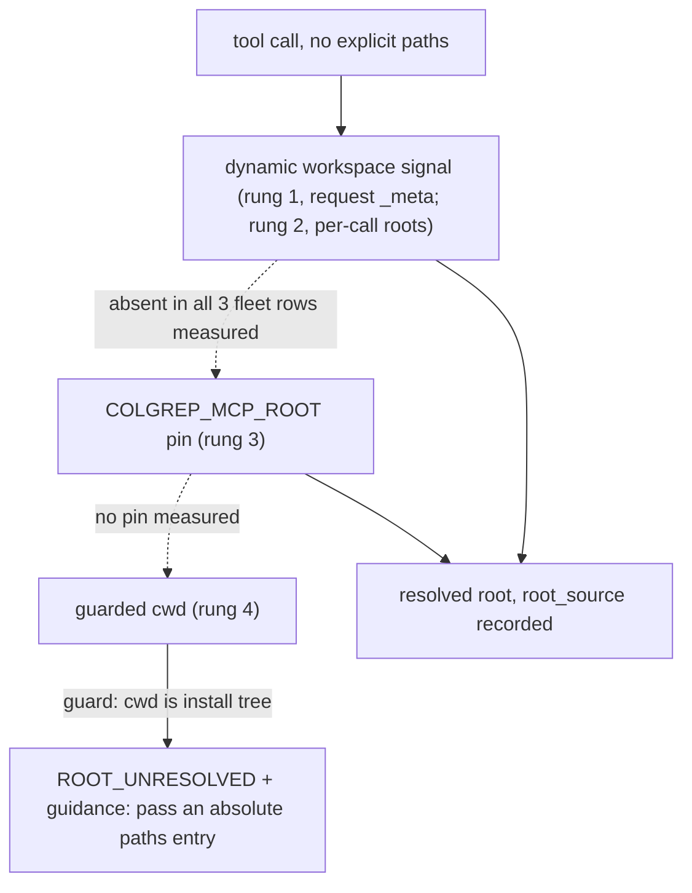

# Harness probe — Findings (v0)

Date: 2026-11-27

---
type: findings
topic: workspace_discovery
date: 2026-11-27
version: v0
prior-version: none
key-metric: dynamic_channels_work: 0 harnesses with a live dynamic rung (prior: N/A, delta: N/A)
decision-required: confirm
---

## Headline Result

metric: dynamic_channels_work
value: 0 — all three fleet harness rows measured silent on every dynamic channel
unit: harnesses with a live dynamic rung measured (of 3 fleet rows; both across-run static cells also `—`)
prior: N/A
direction: new

## Results Tables

### Harness × workspace-signal matrix (fleet rows, condensed from the probe matrix)

Every gap cell is `—` (silence — gap record, no R01-schema fields emitted), or a measured
row is absent from the raw store. No cell is inferred from R03b or any prior run.

| harness | initialize capabilities | request `_meta` keys | `roots/list` verdict | successor (2026-07-28) | spawn env relevant vars | Resolution Picks | Notes |
|:--------|:------------------------|:---------------------|:----------------------|:------------------------|:-------------------------|:------------------|:------|
| `claude` | — | — | — | — | — | `fail+guidance` | gap record `claude_tool-20261127_141546.jsonl`:`{"error": "claude completed but no probe record written"}` — no R01-schema fields emitted |
| `codex` | — | — | — | — | — | `fail+guidance` | gap record `codex_tool-20261127_141606.jsonl`:`{"error": "codex completed but no probe record written"}` — no R01-schema fields emitted |
| `copilot-agent-plugins` | — | — | — | — | — | `fail+guidance` | no `copilot_tool-*.jsonl` present in raw store; reuse-by-filename-match absent, row recorded as `—` |

### Channel map (R02 station ids, per R01 §Per-harness measurement matrix)

| Channel | Station (R02) | Verdict (R02) | Fleet measurement |
|:--------|:--------------|:--------------|:------------------|
| initialize capabilities | Station 3 | static — once per spawn | `—` (no measured cell) |
| request `_meta` keys | Station 2 | dynamic if host stamps | `—` (no measured cell) |
| `roots/list` + successor | Station 1 | static (R02, superseded at the lab level by R03b) | `—` (no measured cell) |
| spawn env `COLGREP_MCP_ROOT` pin | env (launch pin) | static — process lifetime | `—` (no measured pin) |

## Observations

| Signal | Baseline / Expected (R01 ladder) | Observed [source] | Interpretation |
|:-------|:--------------------------------|:------------------|:---------------|
| `request _meta` vendor keys (rung 1: dynamic) | R01 proposed the server read a workspace stamp from per-call `_meta` (R02 Station 2: dynamic input) | `—` in all three fleet rows; gap records `claude_tool-20261127_141546.jsonl` / `codex_tool-20261127_141606.jsonl` hold only `{"error": "… completed but no probe record written"}`; the `copilot-agent-plugins` row has no record at all [source: `probe_data/harness/matrix.md`; `probe_data/harness/raw/claude_tool-20261127_141546.jsonl`; `probe_data/harness/raw/codex_tool-20261127_141606.jsonl`] | No fleet harness was measured stamping a per-call workspace value. The wire mechanism is proven cooperating-client-only (R03b); a real host stamping `_meta` is unmeasured, so the ladder's rung 1 is not exercised by any fleet row and the pick falls past it. |
| `roots/list` per call (rung 2: dynamic) | R01 proposed lazy per-call roots, awaiting the round-trip (rung 2 consumes the R03b race fix) | `—` in all three fleet rows — no `roots/list` verdict recorded for any harness [source: `probe_data/harness/matrix.md`] | The per-call roots channel R03b saw on a cooperating client was not reproduced by any fleet harness run. Rung 2 is unmeasured in the fleet; per-call roots remain a consumption-side capability awaiting a host that answers. |
| `initialize` capabilities (rung source, Station 3) | R01: once-per-spawn announcement, static (R02 Station 3) | `—` in all three fleet rows [source: `probe_data/harness/matrix.md`] | No fleet harness contributed an `initialize` capability probe either; the static rung is unmeasured at the fleet level, so no harness qualifies an initialize-stamped dynamic source. |
| `roots` successor post-2026-07-28 (rung 2 source) | R01 named the successor as a prerequisite before rung 2 promotes roots over the fallback | `—` in all three fleet rows [source: `probe_data/harness/matrix.md`] | No successor channel was observed on any fleet harness. R02's Station-1-open question (name the successor) stays open at the fleet level; the ladder keeps roots as at-best-static during this run. |
| spawn env `COLGREP_MCP_ROOT` pin (rung 3: pin) | R01 rung 3: a static explicit pin outranks inferred signals; only lever if server reads it | `—` in all three fleet rows — no launch env vars measured [source: `probe_data/harness/matrix.md`] | No fleet harness run supplied/measured a `COLGREP_MCP_ROOT` pin. The pin rung is a consumption-side, spawn-time lever; with none measured it is not the pick any harness earned this run. |
| Guarded-cwd fallback + fail+guidance (rung 4) | R01 rung 4: guarded cwd fires `ROOT_UNRESOLVED` + guidance (remedy names an absolute `paths` entry) only when no higher rung produced a root | All three fleet rows fell to the bottom of the ladder: no dynamic signal, no pin → guarded cwd → fail+guidance contract [source: `probe_data/harness/matrix.md`; consumption side already landed on this branch at `157b0a9` (ladder + guided failure)] | With both dynamic channels silent and no pin measured, the ladder's only honest landing for every fleet row is the guarded-cwd rung whose contract is `fail+guidance`: an error naming `paths` with an absolute directory, never a silent wrong root. This is what the measurement dictates, not an invented success. |

### Slice counts (picks distribution)

| R01 rung id | Harnesses it qualifies (measured) |
|:------------|:----------------------------------|
| `dynamic` | 0 |
| `pin` | 0 |
| `guarded-cwd` | 0 (as a *successful* resolution rung — no harness resolved a root) |
| `fail+guidance` | 3 (the bottom contract every silent row falls to) |

## Charts & Visualizations

Caption: measured fall of the fleet harnesses — every row landed past `dynamic` and `pin` (both `—`) onto the guarded-cwd rung's `fail+guidance` contract; no dynamic channel was measured live, so `dynamic_channels_work` counts 0. Units: fraction of the 3 fleet rows exercising each rung = 0/3 for rungs 1–3, 3/3 reaching the guarded-cwd fail+guidance.

## Contradictions & Surprises

- Mechanism vs fleet silence: R03b measured both per-call channels working on the wire (`request _meta` vendor keys and per-call `roots/list`, in `live_lab-a/b_tool-search.jsonl` and both wire transcripts), yet the fleet harness rows are uniformly `—`. The protocol carries the signal; no fleet harness emitted a probe record — the all-`—` matrix reflects sample availability, not a measured absence of the channels.
- R02's Station-1 "static, no successor" verdict was superseded at the lab level by R03b, but the fleet rows still record Station 1 as `—`: supersession happened on a cooperating client, not on any fleet harness — both statements coexist without contradiction once the layer (lab wire vs fleet harness) is named.
- Fleet census gap: two of the three harnesses were transport-auth-gated ("OAuth session expired" for `claude -p`, "401 Unauthorized" for `codex exec`) in the R03b run and reappear here as probe-record gaps; Copilot measured silent in R03b (fell to `cwd` = plugin install tree). A re-probe from authenticated sessions is the only path that can open `—` cells.

## Steering Questions

- [now] Confirm the next-campaign ship scope: obtain live dynamic signals by replaying the two auth-gated harnesses (Claude Code, Codex) against the instrumented server, and re-running the Copilot host probe — until then every fleet row stays `—` and ships nothing new.
- [now] Adopt `fail+guidance` as the production default for all three harnesses meanwhile: with no dynamic channel and no pin measured, the rung-4 contract (error names `paths` with an absolute directory — the pivot the sponsor specified over a bare loud failure) is the only safe resolution, already landed on this branch at `157b0a9`.
- [next run] Name the roots successor (R02 Station 1 opener): only then can rung 2 promote roots over the current fallback; the fleet `—` keeps it deactivated as a rung source for now.
- [next run] Measure the launch pin: the fleet recorded no `COLGREP_MCP_ROOT` value; a spawn-time pin probe would isolate whether rung 3 (pin) needs host support or is purely a server consumption-side lever.
- [later] Decide the serve-side `_meta`-consume and roots race-fix integration timing (lab-proven in R03b, landed in `6c1cb8a`/`30aad59`) against host-side stamping once a fleet harness actually stamps one of the channels.

## Pointers

- [matrix](../../__reports__/workspace_discovery/probe_data/harness/matrix.md)
- [claude gap record](../../__reports__/workspace_discovery/probe_data/harness/raw/claude_tool-20261127_141546.jsonl)
- [codex gap record](../../__reports__/workspace_discovery/probe_data/harness/raw/codex_tool-20261127_141606.jsonl)
- [live lab a](../../__reports__/workspace_discovery/probe_data/harness/raw/live_lab-a_tool-search.jsonl)
- [live lab b](../../__reports__/workspace_discovery/probe_data/harness/raw/live_lab-b_tool-search.jsonl)
- [wire 2026-07-28](../../__reports__/workspace_discovery/probe_data/harness/raw/wire-2026-07-28.log)
- [wire 2025-11-25](../../__reports__/workspace_discovery/probe_data/harness/raw/wire-2025-11-25.log)
- [R02 protocol survey](../../__reports__/workspace_discovery/01-findings_protocol_survey_v0.md)
- [R03b live probe](../../__reports__/workspace_discovery/03-findings_live_probe_v0.md)
- [dump-only signature](../../__reports__/workspace_discovery/04-findings_dump_only_signature_v0.md)
- [R01 architecture](../../__reports__/workspace_discovery/00-architecture_v0.md)

## Decision

**decision-required = confirm**: ship the next campaign from the fleet's measured silence. `dynamic_channels_work` counts 0 — every fleet harness row is `—` on request `_meta`, per-call roots, and the rest; the per-harness `Resolution Picks` are all `fail+guidance`, the rung R01's ladder falls to when both dynamic channels and any pin are silent. So the next campaign's per-call resolution ship scope is: wire `resolve_target_paths` to consume the lab-proven channels only where a fleet harness actually stamps one (the `request _meta` consume and per-call roots await/cache landed at `6c1cb8a`/`30aad59`; the ladder + `ROOT_UNRESOLVED` guided failure at `157b0a9`), and default every harness that still ships `—` to the fail+guidance contract — an error naming `paths` with an absolute directory as the remedy (the sponsor-specified pivot, never a bare loud failure and never a silent wrong root) — until a re-probed, authenticated fleet run yields live dynamic signals that promote a harness onto the `dynamic` rung.
