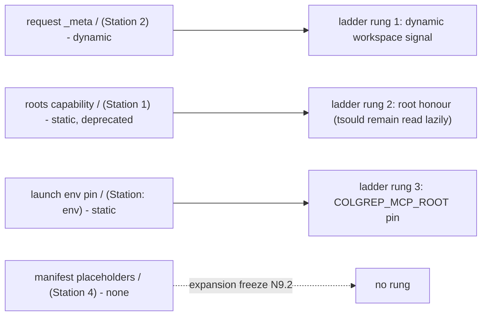

# Workspace channels — Findings (v0)

Date: 2026-11-13

---
type: findings
topic: workspace_discovery
date: 2026-11-13
version: v0
prior-version: none
key-metric: dynamic_channels_found: 2 of 3 stations can carry a per-call workspace value (prior: N/A, delta: N/A)
decision-required: confirm
---

## Headline Result

metric: dynamic_channels_found
value: 2
unit: stations of 3 capable of per-call (dynamic) resolution
prior: N/A
direction: new

## Results Tables

### Station verdicts (R01 R02 stations)

| Station | Verdict | evidence_for | invoker | duration | invoker_coverage |
|:--------|:--------|:--------------|:--------|:---------|:-----------------|
| 1. client roots capability (roots/list + roots/list_changed + successor) | static | server/colgrep_mcp/paths.py S.client_roots docstring (in-fleet artifact, self-declared deprecated as of the 2026-07-28 protocol revision); lead-observed run warning on mcp SDK 2.2.0: MCPDeprecationWarning in mcp/server/mcpserver/context.py line 374 (The logging capability is deprecated as of 2026-07-28 (SEP-2577)) | host | once per spawn at best | partial: any value is a then-current snapshot; a roots successor could push it (the what-could-settle-it opener below) |
| 2. request _meta on tools/call | dynamic | mcp SDK 2.2.0 ServerRequestContext exposes meta: RequestParams.Meta (progress_token) per implementer report 6fd3edc inspection of server/.venv pins; cross-checked lead-side against that pin's context.py import | host | per call | full if the host stamps it; item under Contract (S01) records whichever par is there -- absence is recorded as None |
| 3. initialize handshake context | static | AGENTS.md report legend R05 M1 (client_roots measures the initialize result's declared capability, not a stale enumeration; agent-plugins Oslo absent implies no addressable dynamic source -- kept as claim of shape in R01 S01) | host | once per spawn | partial: one announcement per session; workspace switch mid-life needs a new source |

### Channel mechanism boundary (formats and triggers)

| Channel | Window | Trigger | Validation | Notes |
|:--------|:-------|:----------|:-----------|:------|
| MCP request meta (_meta on tools/call) | per call | every tool call | the probe dump schema keys init_capabilities / request_meta; recorded verbatim whether present or absent | terminal candidate for the 2026-07-28 clarification yes or no; the ZERO UNKNOWN from R01 stays frozen |
| MCP roots (list + list_changed) | session | handshake, push notification | deprecation recorded by being one-shot's self-announcement plus the SDK 2.2.0 deprecation string naming SEP-2577 (see query card below) | if a successor channel exists (dynamic roots / URI templates, plural-but-unknown), it too rides the SAME wire: needs a name before the ladder promotes rung 1 |
| Launch env (COLGREP_MCP_ROOT pin) | process lifetime | spawn (host or user recipe) | Settings.from_env flips a literal; pin outranks new dynamic sources by design (R01 S01) | this is the storyboard's static pin; accepted defect label -- stale on workspace switch, one-shot by nature |
| plugin-manifest placeholders | none | none | Agent Plugins 1.0 S9.2 expansion freeze: only ${PLUGIN_ROOT} / ${PLUGIN_DATA}; unconforming text stays literal | cannot carry a host workspace value in a spec-conformant client; a fourth manifests channel does not exist |

## Observations

| Signal | Baseline / Expected | Observed [source] | Interpretation |
|:-------|:--------------------|:------------------|:----------------|
| Deprecation timestamp in the wild | R01 and paths.py both cite a 2026-07-28 protocol revision; no ground truth seen | mcp SDK 2.2.0 emits a real MCPDeprecationWarning naming 2026-07-28 SEP-2577 [source: lead-side re-gate of task/probe-instrumentation, 2026-11-13, .venv site-packages pin] | The 2026-07-28 revision exists AS A TIMESTAMP the ship-the-pin SCHEDULE references; whether it replaced roots/list wholesale is NOT established from this datum alone (SEP-2577 is the LOGGING deprecation, not a roots one). Verdict cell stays static + the opener below. |
| Station 2 (per-call meta) capability | R01 expected the launch-time hierarchy for 2 and 3 | ServerRequestContext carries a meta field (RequestParams.Meta with progress_token) [source: implementer 6fd3edc reading of mcp SDK 2.2.0 .venv source] | Structurally the channel a host could stamp per call; whether the three surveyed hosts DO stamp is a harness facts question (R03 probe fleet -- level-2 pre-condition). |
| Manifest channel scope | Two plugin-variable placeholders might cover a workspace ala Claude Code's ${CLAUDE_PROJECT_DIR} | Agent Plugins 1.0 S9.1-S9.2: clients MUST NOT perform any other expansion; env values are opaque strings not secrets [source: lead-verified fetch of agent-plugins.org/specification S9.1-S9.2] | Confirms prior analysis: within Agent Plugins, a pinned value is supplied at spawn (host or user), never read from the package. |
| Fleet gap safety | R01 requires every cell a raw measurement or an honest gap | Two protocol-survey dispatch rounds never ran (zero turns, session suspension) [source: task tool history, campaign lead] | This report itself surveys mechanism; behavioural cells are R03's target and remain unfilled by design -- gap stays visible rather than fabricated. |

## Charts & Visualizations

Caption: rung provenance for each measured channel; only Station 2 is dynamic, and only if the host stamps it (the fleet probes decide per host).

## Contradictions & Surprises

- Name-of-revision real, subject-matter mismatch: SEP-2577 (the thing that names 2026-07-28 in the observed warning) is the LOGGING deprecation, not a roots one. The repo's own claim that roots is deprecated "as of the 2026-07-28 revision" may rest on a different SEP never pinned in-fleet (see Steering [later]).

## Steering Questions

- [now] Confirm one acceptance before R03: when every dynamic station is absent for a host, the failure is fail+guidance (error names an absolute `paths` entry as the remedy), per sponsor decisions -- no silent fallback to install-dir cwd (close the ladder there).
- [now] Name the roots successor (or confirm there is none): searches `roots/list` successor means promoting rung-1 roots over the current fallback instead of folding roots INTO the workspace signal. Until named the roots channel stays static at best, deactivated as a rung source.
- [next run] R03 fleet: measure whether hosts actually stamp request meta / a roots successor; the mechanism this survey establishes cannot answer the behavioural point.
- [later] Pin canon: which SEP replaced/expanded roots (SEP-2577 family). Requires context7-mcp (the user-specified third-party channel) -- beyond raw local pins; recorded so the next session starts this probe where this one ended.

## Pointers

- ../../__roadmap__/workspace_discovery/README.md (campaign gates, ownership)
- ../../__reports__/workspace_discovery/00-architecture_v0.md (R01 law and matrix contract)
- ../../server/colgrep_mcp/paths.py (in-fleet client_roots self-claim)
- ../../server/colgrep_mcp/probe.py (dump schema keys to be confirmed at R03; file withdrawn at c7c6377 pending the hardening fix, see 02-gap_analysis_calibrated_probe_v0.md)
