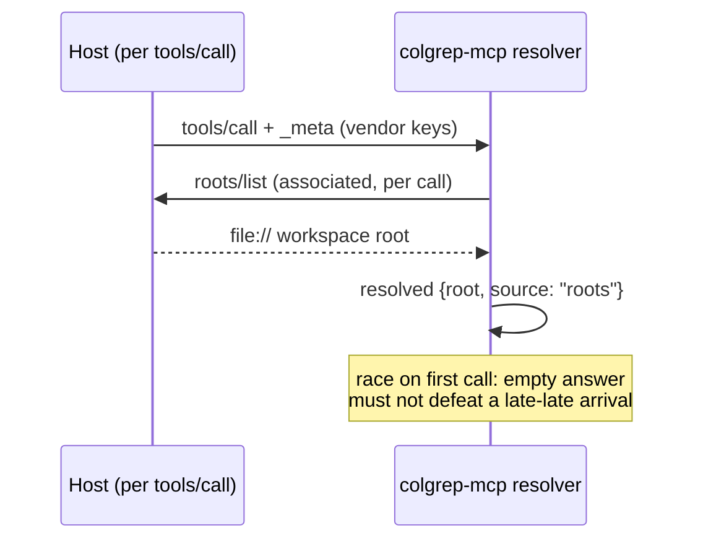

# Live workspace-signal probe — Findings (v0)

Date: 2026-11-13

---
type: findings
topic: workspace_discovery
date: 2026-11-13
version: v0
prior-version: none
key-metric: dynamic_resolution_live: YES (measured on the wire; host-dependent) (prior: N/A, delta: N/A)
decision-required: confirm
---

## Headline Result

metric: dynamic_resolution_live
value: YES — both per-call channels measured working; one host measured silent
unit: wire-verified channels of 2; host rows: 1 measured / 2 gated on auth
prior: N/A
direction: new

## Results Tables

### Channel measurement (lab wire probe, pinned mcp 2.2.0)

| Channel | Negotiation | Measured behaviour | Per-call workspace? |
|:--------|:------------|:-------------------|:--------------------|
| request `_meta` vendor keys | both (2026-07-28 offered / 2025-11-25) | stamped keys (`com.example.workspace`, `com.example.note`) arrived verbatim in `request_meta` on the stamped call; `request_meta: null` on the unstamped control | **YES** |
| client roots (per-call `roots/list`) | both | `roots/list` emitted **during each `tools/call`** on the wire; answered `file:` root became `resolved {root: …/fakews, source: "roots"}`; unanswered round-trip fell back `{source: "cwd"}` | **YES** (with first-call race, below) |
| protocol dialect (server side) | both | server negotiated `2025-11-25` in both runs regardless of client offer; MRTR (`ListRootsRequest`) types present in SDK, unwired; `init_capabilities: null` (SDK exposes `client_capabilities`/`protocol_version` instead) | n/a — ceiling known |

### Host rows

| Host | Row source | Workspace per call? | Evidence |
|:-----|:-----------|:--------------------|:---------|
| Copilot (VS Code Agent Plugins, this session) | live observation of the shipped plugin server | **NO** — fell through to `cwd` = plugin install tree | `doctor` reported `default_root …/agentPlugins/…/1a1c9036c4d (source: cwd)`; path-less `search` returned only plugin-tree hits |
| Claude Code | attempted `claude -p` + instrumented server (`--mcp-config`) | unknown (gap) | `Failed to authenticate: OAuth session expired` — the documented `stack-traps` `{#oauth}` case; run command ready to replay |
| Codex | attempted `codex exec` with isolated `CODEX_HOME` | unknown (gap) | `401 Unauthorized: Missing bearer` (no credentials used, per policy); run command ready to replay |

### Measured defects feeding the implementation leaf

| Defect | Observation | Consequence |
|:-------|:------------|:------------|
| First-call roots race | call 1 recorded twice: first resolve `{items: [], static: "empty"} → source: "cwd"}`, second resolve same call `{items: [fakews]} → source: "roots"}` — identical pattern in **both** negotiation runs | the first tool call can resolve to the wrong root even when the host answers; resolver must await/cache the round-trip before falling back |
| `tool` column fabrication | every ledger row reads `"tool": "record"` | matrix attribution unusable until the thread-inspection fix (verifier lever 1) |
| `init_capabilities` blind spot | `null` on every row though the SDK exposes `client_capabilities`/`protocol_version` | probe schema must key on the 2026-07-28 presence-stable fields (suspected R2' defect, now live-confirmed) |

## Observations

| Signal | Baseline / Expected | Observed [source] | Interpretation |
|:-------|:--------------------|:------------------|:----------------|
| `_meta` vendor keys reach the server intact | R02 gap-analysis reservation "needs behavioural proof" | verbatim in `request_meta` on stamped call; `null` on control [source: probe_data/harness/raw/live_lab-a_tool-search.jsonl, live_lab-b] | the projection-route channel is real and parser-ready; per-key lookup is trivially safe to implement |
| roots resolves the workspace per call | R02 verdict "Station 1 static" (superseded) | `roots/list` per call on wire; answer became `resolved.source: "roots"` [source: wire-2026-07-28.log, wire-2025-11-25.log] | R02's station verdict was wrong about dynamics: with a cooperative client the ladder already resolves per call — the fix is consumption-side, not protocol-side |
| Copilot sends neither channel | the original bug report | `source: "cwd"` measurements this session [source: live-session `doctor` + path-less `search` results] | the user's symptom is exactly the host row of this table; server-side robustness + host `_meta`/roots support are the two halves |
| LLM-host census | 3 host rows expected | 2 rows blocked on transport auth, not protocol [source: claude -p / codex exec stderr tails, recorded in the run transcript] | replay cost is one authenticated session per host; commands pinned in the run notes |

## Charts & Visualizations

Caption: the measured happy path — both channels on one call; the noted race is the one defect found.

## Contradictions & Surprises

- R02 (01-findings_protocol_survey_v0.md) recorded Station 1 as `static`/no successor; the live wire shows per-call `roots/list` dynamics under the pinned SDK. Superseded by measurement, as intended by the gap-analysis remit.

## Steering Questions

- [now] Confirm the server fix scope for the next cycle: consume `_meta` vendor keys + proper per-call roots await/cache (race fix) + fail+guidance on empty; host `_meta`/roots support is the harness-side ask.
- [now] Replay the two host rows from an authenticated session (commands recorded above) before the R03 matrix closes `—` cells.
- [next run] Hardening (referential: `probe_hardening` remedy) lands before any production probe, per 02-gap_analysis; this lab run's ledger parsing is safe precisely because rows were schema-grepped at ingest.

## Pointers

- probe_data/harness/raw/live_lab-a_tool-search.jsonl — stamped/control records, negotiation offered 2026-07-28
- probe_data/harness/raw/live_lab-b_tool-search.jsonl — replication run, negotiation 2025-11-25 (identical 3-record pattern)
- probe_data/harness/raw/wire-2026-07-28.log, wire-2025-11-25.log — per-message JSON-RPC transcripts (roots/list emission per call)
- 01-findings_protocol_survey_v0.md — R02, read with the Contradiction above
- 02-gap_analysis_calibrated_probe_v0.md — the hardening remedy whose gate this run respected
